# Home SOC Lab — Wazuh SIEM Detection of SSH Brute-Force

A self-built Security Operations Center lab that detects a simulated SSH brute-force
attack end-to-end: attack → log ingestion → SIEM correlation → alert.

## Architecture

```
┌─────────────────┐        NAT Network          ┌──────────────────────┐
│   Kali Linux     │      "SocLab"               │   Ubuntu (target +    │
│   (Attacker)     │      192.168.50.0/24         │   Wazuh SIEM)          │
│   192.168.50.3   │ ───────────────────────────▶ │   192.168.50.4         │
│                  │   hydra SSH brute-force      │                        │
│                  │   nmap port scan             │   Wazuh manager        │
│                  │                              │   + indexer            │
│                  │                              │   + dashboard          │
│                  │                              │   sshd + auth.log      │
│                  │                              │   bait account:        │
│                  │                              │   victim/password123   │
└─────────────────┘                               └──────────────────────┘
```

**Host:** VirtualBox on Windows, Samsung Galaxy Book5 360 (Intel Core Ultra 7, 16 GB RAM)

## Tools used

- **VirtualBox** — NAT Network virtualization (`SocLab`, 192.168.50.0/24)
- **Wazuh 4.x** — SIEM: manager, indexer, and dashboard, self-installed on Ubuntu
- **Kali Linux** — attack platform
- **Hydra** — SSH brute-force tool
- **Nmap** — reconnaissance / port scanning

## What this demonstrates

1. Stood up a segmented virtual network and installed a production-grade SIEM
   (Wazuh) from scratch, including manager/indexer/dashboard configuration.
2. Configured log ingestion (`/var/log/auth.log` via `localfile`/syslog) so SSH
   authentication events reach the SIEM.
3. Simulated a real attack chain from an external attacker VM:
   - `nmap` reconnaissance against the target
   - `hydra` SSH brute-force against a bait account (`victim`)
4. Verified detection in Wazuh Discover, filtered on the attacker's source IP
   (`data.srcip:192.168.50.3`) — **28 matching events**, including:
   - `sshd: authentication failed` (rule level 5) — repeated failed logins
   - `sshd: brute force trying to get access to the system` (rule level 10)
   - `PAM: Multiple failed logins in a small period of time` (rule level 10)
   - **`Multiple authentication failures followed by a success`** (rule level 12)
     — Wazuh's compromise-detection rule, confirming the bait account was
     successfully cracked and the SIEM flagged it correctly.
5. Diagnosed and fixed a real operational incident along the way (see
   [Lessons Learned](#lessons-learned)) rather than following a fixed script.

See the full write-up: [`docs/incident-report-ssh-bruteforce.md`](docs/incident-report-ssh-bruteforce.md)

## Screenshots

**Network setup**

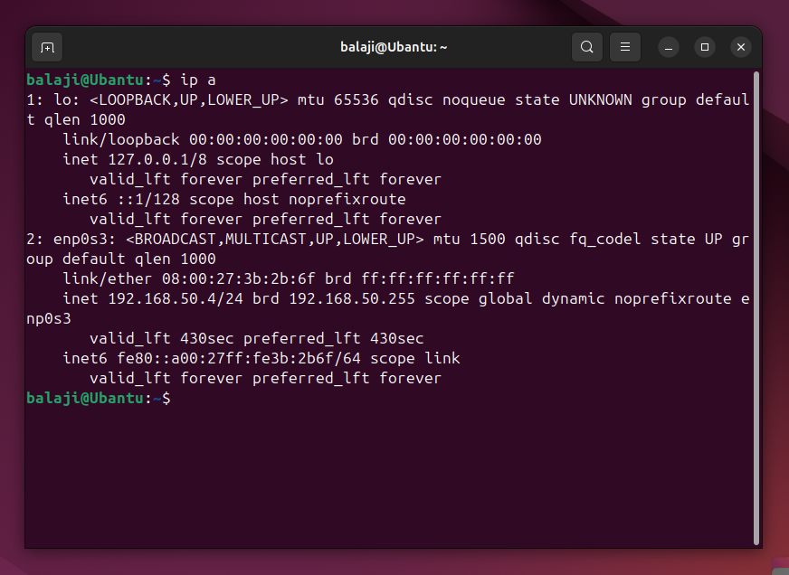
*`ip a` on Ubuntu confirming lab network (192.168.50.4)*

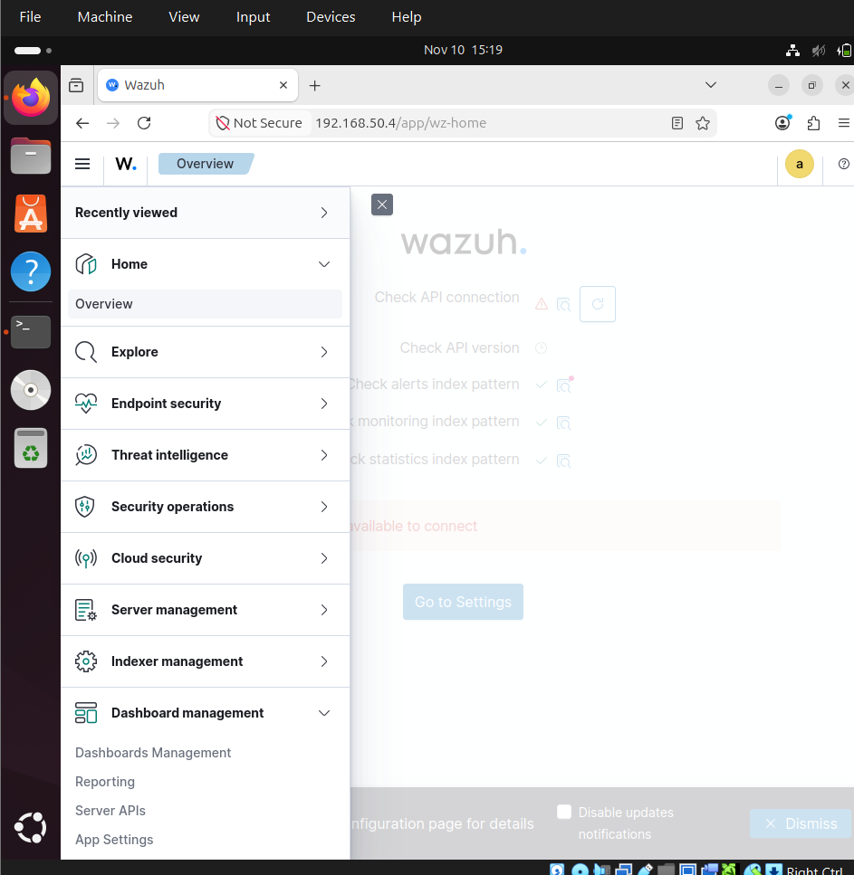
*Wazuh dashboard navigation*

**The disk-full incident (see [Lessons Learned](#lessons-learned))**

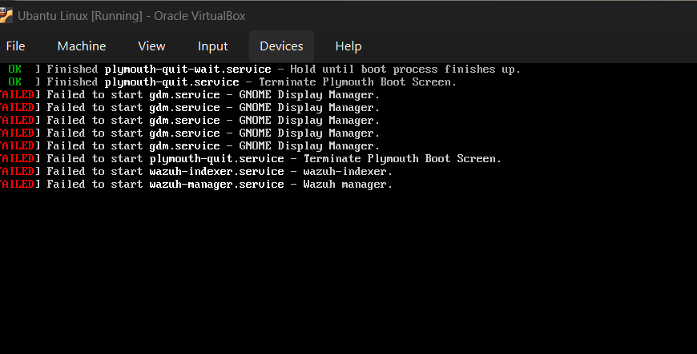
*Services (incl. `wazuh-indexer`, `wazuh-manager`) failing to start after the disk filled*

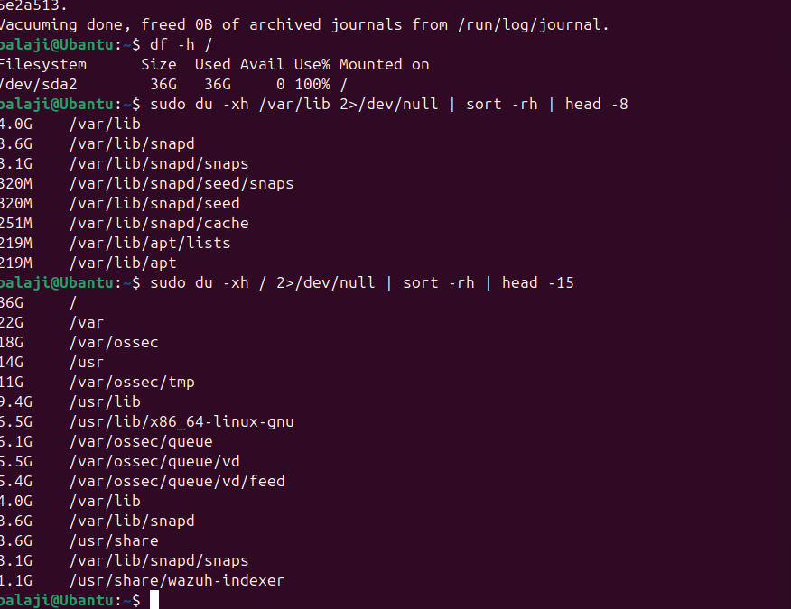
*`df -h` / `du -xh` showing the disk at 100% and what was consuming space*

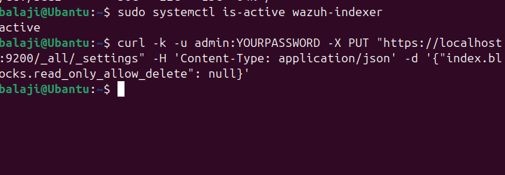
*Indexer recovery commands after clearing disk space*

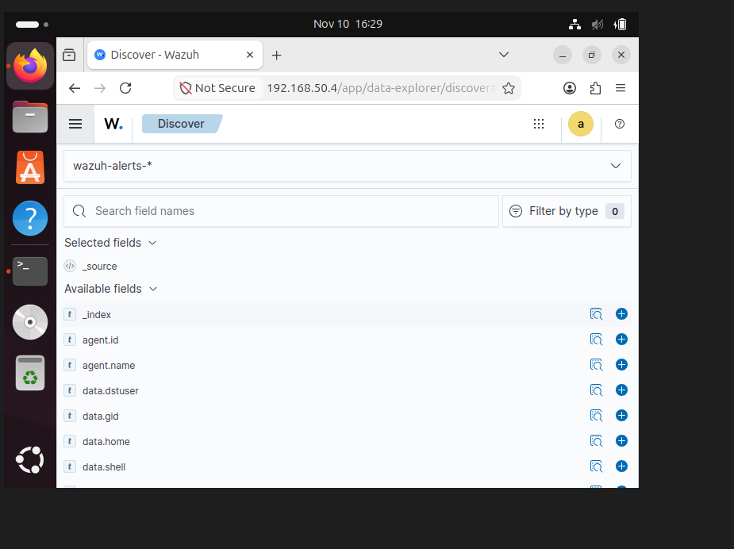
*Confirmation that log ingestion resumed post-recovery (370 hits)*

**The attack and detection**

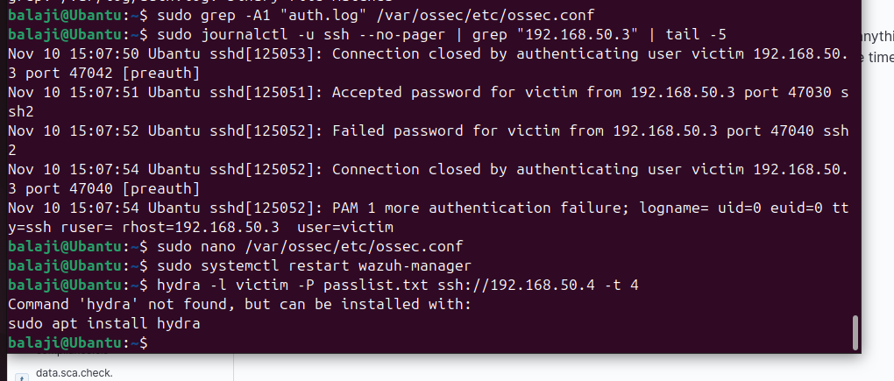
*Raw `journalctl` sshd evidence from the attacker IP, and the initial `hydra: command not found`*

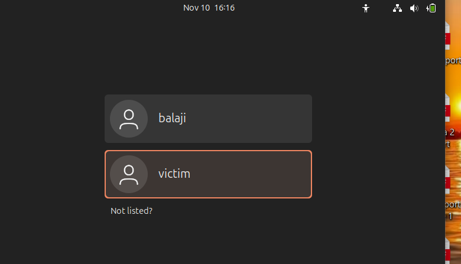
*Ubuntu login screen showing the `victim` bait account*

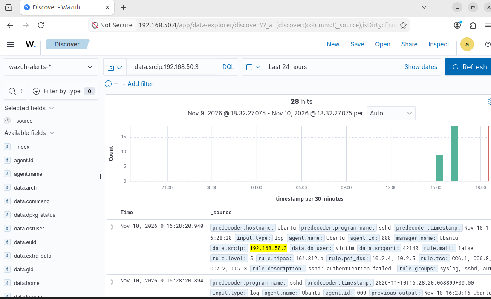
*Wazuh Discover filtered on `data.srcip:192.168.50.3` — 28 hits, histogram view*

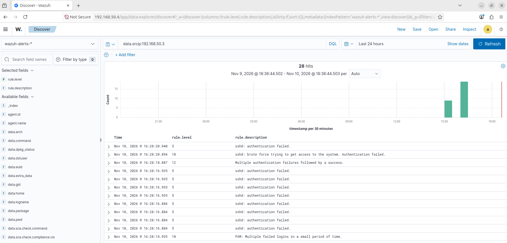
*Rule-level breakdown: repeated auth failures, brute-force rule, PAM alerts*

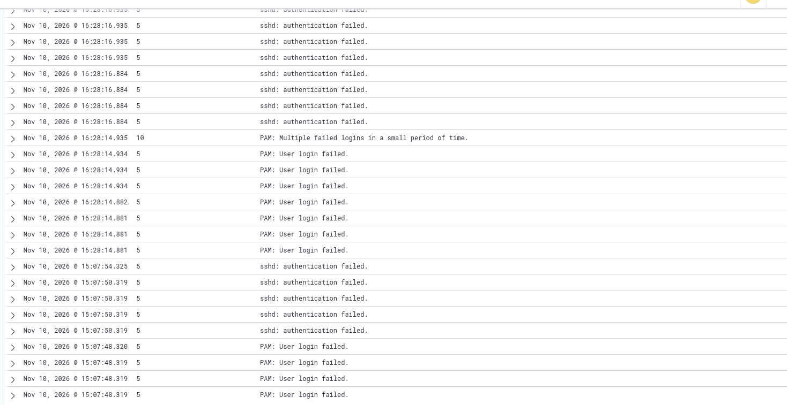
*The level-12 "Multiple authentication failures followed by a success" alert — confirmed compromise detection*

**Misc (redacted)**

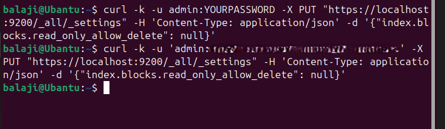
*Re-enabling the indexer after the disk-full recovery (password redacted)*

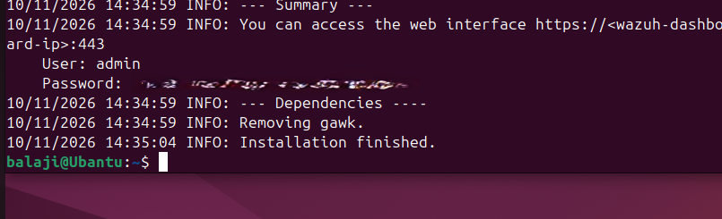
*Wazuh install completion summary (password redacted)*

## Lessons learned

The Ubuntu VM's 36 GB disk filled to 100%, which pushed the Wazuh indexer into
read-only mode and interrupted log ingestion mid-lab. Root-caused it to
`/var/ossec/tmp` and `queue/vd` (vulnerability-detection feed data) consuming
most of the space. Recovered via Ubuntu recovery mode, cleared the offending
directories, disabled the vulnerability-detection module to stop the feed from
refilling, and resized the virtual disk to prevent recurrence. This is a real
SIEM operations problem — storage/retention planning for ingested logs — not
just following a tutorial, and it's the kind of thing I'd expect to manage in
an actual SOC/analyst role.

## Next steps

- [ ] Add a second attack scenario (port scan → alert) with its own incident report
- [ ] Re-enable vulnerability-detection now that disk headroom exists
- [ ] Add MITRE ATT&CK mapping as a Wazuh dashboard visualization, not just in the report

---
*Built by Balaji — CSE student, targeting SOC Analyst (L1) roles.*
